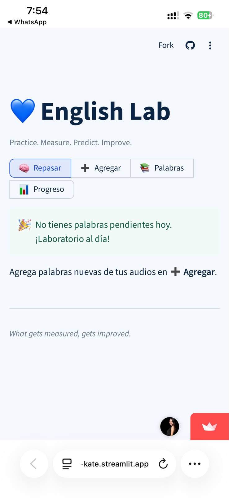

# 💙 English Lab

**Practice. Measure. Predict. Improve.**

> *"What gets measured, gets improved."*

🌐 **Live app:** [english-lab-kate.streamlit.app](https://english-lab-kate.streamlit.app) — password-protected, because it holds my real learning data.

English Lab is my personal app for learning English, built as a data science project.
I am a data analyst on my way to data science, and I am using my own English learning as the case study:
I practice every day on my phone, the app records every review, and I analyze the data to see — and later predict — how I learn.

## On my phone



*Version 1, November 19, 2026 — my daily practice happens here.*

## What it does (version 1)

- **Save words** that I hear in English listening videos, with meaning and example.
- **Spaced repetition:** each word comes back after 1, 3, 7, 14, 30 or 60 days, depending on whether I remember it.
- **Listen:** hear each word and example in normal and slow speed (browser voice).
- **Progress dashboard:** saved words, learned words, accuracy and study streak.
- **Data export:** a CSV with every review, for analysis.

Every review is stored with its date, result, response time, exercise type and days since the last review.
That is the training data for the prediction model.

## Roadmap

1. ✅ Base app: words, spaced repetition, audio and progress.
2. ⬜ Listening (dictation) and speaking (pronunciation) practice.
3. ✅ Online version for daily practice on my phone.
4. ⬜ Daily Telegram alerts: morning *memory forecast* and evening *lab report*.
5. ⬜ Analytics: consistency, most forgotten words, study time.
6. ⬜ Machine learning: predict which words I am about to forget.

## Results

*Coming soon — real data only.* My starting level will be measured with the EF SET test.

## Tech

Python · Streamlit · pandas · SQLAlchemy · SQLite / PostgreSQL · Altair

## Run it locally

```bash
pip install -r requirements.txt
python -m streamlit run app.py
```

---

Built by **Katerine Gomez**, with AI as a development assistant.
